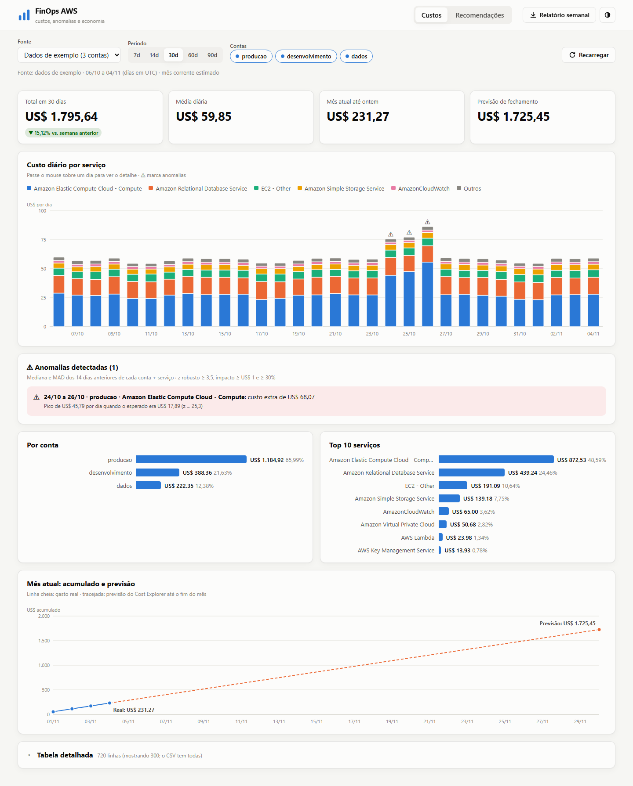
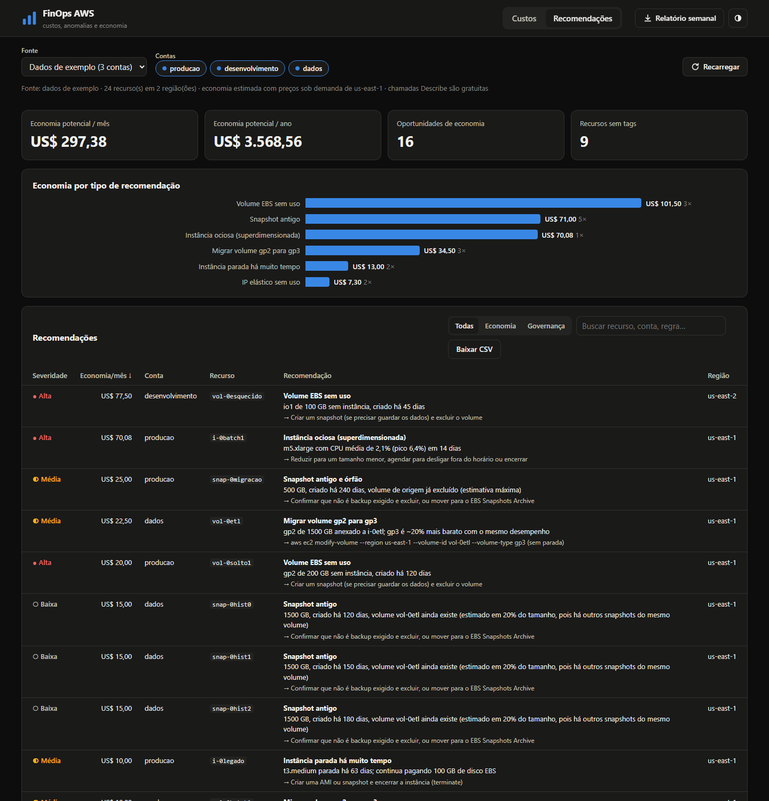
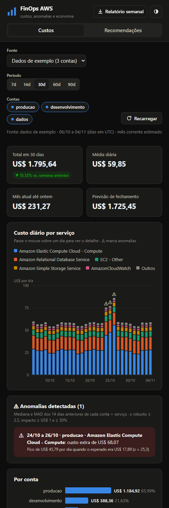

# FinOps AWS

[](https://github.com/pabloaugustoti/finops-aws/actions/workflows/testes.yml)


[](https://docs.astral.sh/ruff/)
[](https://mypy-lang.org/)
[](LICENSE)

**Multi-account AWS cost monitoring**: shows where the money goes, flags spending that breaks the pattern, and points out what can be saved, with the exact command to act on it.

It runs **on your own machine**, accesses AWS with **read-only permissions**, and ships a **hand-built** web interface (plain HTML, CSS and JavaScript, no frameworks).

🇧🇷 [Versão em português](README.md) · The interface, CLI and project journal are in Brazilian Portuguese.



---

## Features

| | |
|---|---|
| 📊 **Costs** | Total, daily average, month-to-date and **month-end forecast**. Daily cost by service; rankings by account and service. |
| ⚠️ **Anomalies** | Detects days that break the pattern for each account and service (median + MAD) and reports the extra cost of each event. |
| 💡 **Savings** | 7 rules: idle instance, unattached EBS volume, idle Elastic IP, long-stopped instance, gp2→gp3, old/orphaned snapshot and untagged resources. Each comes with an **estimated monthly saving** and a suggested action. |
| 🏢 **Multi-account** | Assumes a **read-only** role in each account (`sts:AssumeRole`), no long-lived keys. If one account fails, the others keep going. |
| 📝 **Weekly report** | Markdown ready for email, Slack or a wiki: week over week, anomalies and top savings. |

<table>
  <tr>
    <td width="72%"></td>
    <td width="28%"></td>
  </tr>
</table>

<sub>Screenshots use **sample data mode**: 3 fictional accounts with deliberately planted waste and one cost anomaly.</sub>

## Quick start (no AWS account needed)

Requires Python 3.12+.

```powershell
python -m venv .venv
.\.venv\Scripts\python.exe -m pip install -e .
.\.venv\Scripts\python.exe -m finops web        # opens http://127.0.0.1:8000 with sample data
```

## Technical highlights

| Decision | Why |
|---|---|
| **Cache with a validity rule** ([`cache.py`](src/finops/cache.py)) | Cost Explorer charges US$ 0.01 per request. Closed periods are cached forever; the open (estimated) month expires after 6 h. |
| **Read-only role as CloudFormation** ([template](infra/cloudformation/finops-readonly-role.yaml)) | Least privilege, verified: `CreateVolume` returns `UnauthorizedOperation` when the role is assumed. |
| **Median + MAD anomaly detection** ([`anomalies.py`](src/finops/anomalies.py)) | The spike itself doesn't skew the baseline. Finds exactly the planted anomaly with no false positives across the other 23 series. |
| **Honest savings estimates** ([`recommendations.py`](src/finops/recommendations.py)) | No double counting (gp2→gp3 vs. stopped instance) and snapshots treated as incremental: the sample total dropped from US$ 484 to a defensible US$ 297. |
| **Standard-library web server** ([`server.py`](src/finops/web/server.py)) | Binds to `127.0.0.1`, GET only, CSP `default-src 'self'`, path-traversal protection, all covered by tests. |
| **Hand-drawn SVG charts** ([`charts.js`](src/finops/web/static/charts.js)) | Scales, axes, tooltip and crosshair without a charting library; colorblind-safe palette with a dedicated dark theme. |
| **Sample client mirrors the real API** ([`sample_client.py`](src/finops/sample_client.py)) | The rest of the code can't tell sample data from real data, so the project can be demoed and tested without AWS. |
| **SCP handled as governance, not as an error** | The account lives in an organization that blocks 16 regions; the inventory reports that in one line instead of 16 errors. |

## Commands

| Command | What it does |
|---|---|
| `finops web` | Web interface at `http://127.0.0.1:8000` |
| `finops resumo` | Cost summary in the terminal (`--csv` to export) |
| `finops recomendacoes` | Savings opportunities (`--regioes`, `--csv`) |
| `finops anomalias` | Cost anomaly events (`--sensibilidade`) |
| `finops relatorio` | Weekly Markdown report (`--saida file.md`) |
| `finops verificar-contas` | Tests AssumeRole and read access in each account |

All accept `--fonte exemplo` (default, no AWS), `--fonte aws --perfil <profile>` (one account) or `--fonte contas` (many, via `accounts.local.toml`).

## Using real accounts

1. Log in with the AWS CLI: `aws login --profile finops-lab` (temporary credentials, no keys).
2. In each monitored account, deploy the read-only role with the hub account ID:
   ```powershell
   aws cloudformation deploy --template-file infra/cloudformation/finops-readonly-role.yaml `
     --stack-name finops-readonly-role --capabilities CAPABILITY_NAMED_IAM `
     --parameter-overrides TrustedAccountId=<HUB_ACCOUNT_ID> --profile <account-profile>
   ```
3. Copy [`accounts.example.toml`](accounts.example.toml) to `accounts.local.toml` (git-ignored) and list your accounts.
4. Check with `python -m finops verificar-contas`, then run `python -m finops web` and pick **Várias contas**.

## Code quality

ruff (lint, including security rules, and formatting), mypy, 80 tests with 92% coverage (90% minimum enforced) that never touch AWS, pre-commit hooks, and GitHub Actions running everything on Python 3.12 and 3.14 for every PR.

## How it was built

Every step became a pull request and a journal entry (in Portuguese) covering what was done, the decisions, the problems found and what I learned: see [`docs/diario/`](docs/diario/) and the [CHANGELOG](CHANGELOG.md).

## License

[MIT](LICENSE). Personal study and portfolio project: no company involved and no real third-party data.
