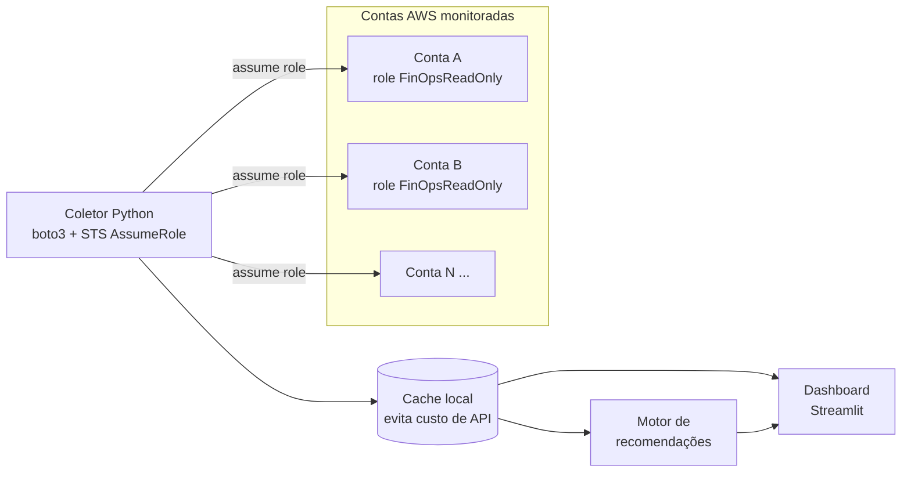

# FinOps AWS: monitoramento de custos multi-conta

Projeto pessoal de estudo para aprender **FinOps na AWS** na prática. A ideia é construir, passo a passo, uma aplicação que:

- reúne os custos de **várias contas AWS** num só lugar, usando APIs e roles somente leitura;
- mostra **dashboards** de custo por conta, serviço, tag e período;
- encontra **oportunidades de economia**: recursos ociosos, tamanho exagerado, armazenamento antigo etc.

> Projeto de curiosidade e portfólio. **Nenhuma empresa está envolvida** e nenhum dado real de terceiros é usado.

## Arquitetura planejada



**Fontes de dados AWS usadas:**

| Fonte | Uso | Custo |
|---|---|---|
| Cost Explorer API | Custos por serviço, conta, tag e previsão | US$ 0,01 por requisição |
| Compute Optimizer | Sugestões de tamanho certo (EC2, EBS, Lambda) | Gratuito |
| Budgets | Alertas de gasto | Básico gratuito |
| EC2 / EBS / S3 APIs | Inventário para achar desperdício | Gratuito |
| Data Exports (CUR 2.0) + Athena | Detalhe completo de faturamento (fase avançada) | S3 + consultas |

## Roteiro

- [ ] **Fase 1: Fundação**
  - [x] Ferramentas instaladas (Git, Python 3.14, AWS CLI v2)
  - [x] Repositório criado com `.gitignore` protegendo credenciais
  - [ ] Conta AWS criada, MFA no root, usuário administrativo via IAM Identity Center
  - [ ] Budget com alerta e Cost Explorer ativado
- [ ] **Fase 2: Coletor de uma conta**: Python + boto3 lendo o Cost Explorer, com modo de dados de exemplo
- [ ] **Fase 3: Várias contas**: arquivo de configuração das contas e `sts:AssumeRole` em roles somente leitura
- [ ] **Fase 4: Dashboard**: Streamlit com visão por conta, serviço, tendência e previsão
- [ ] **Fase 5: Recomendações**
  - [ ] Volumes EBS gp2 que podem virar gp3
  - [ ] Volumes EBS sem uso e IPs elásticos ociosos
  - [ ] Snapshots antigos
  - [ ] Instâncias paradas, ociosas ou maiores do que precisam
  - [ ] Recursos sem tags de alocação de custo
- [ ] **Fase 6: Avançado**: CUR 2.0 + Athena, detecção de anomalias, alertas

## Princípios de segurança

1. **Nenhuma credencial no repositório.** O acesso usa perfis do AWS CLI (`aws configure sso`), nunca chaves no código.
2. **Somente leitura.** A aplicação só lê dados e nunca altera recursos nas contas.
3. **Menor privilégio.** Cada conta monitorada expõe uma role com permissões mínimas de leitura.
4. **Dados reais fora do Git.** Exportações e cache ficam em `data/`, que é ignorada pelo Git.

## Diário de estudos

Cada etapa fica registrada em [`docs/diario/`](docs/diario/):

- [01: Preparação do ambiente](docs/diario/01-preparacao-ambiente.md)

## Estrutura

```
finops-aws/
├── docs/
│   ├── diario/            # registro de cada etapa
│   └── checklist-conta-aws.md
├── src/                   # código (a partir da fase 2)
├── data/                  # cache e exportações (ignorado pelo Git)
└── README.md
```
