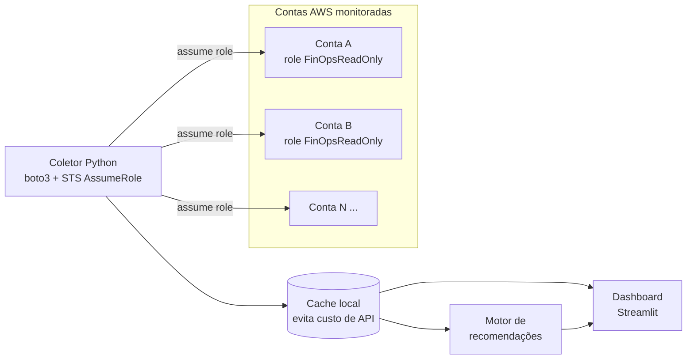

# FinOps AWS: monitoramento de custos multi-conta

Projeto pessoal de estudo para aprender **FinOps na AWS** na prática. A ideia é construir, passo a passo, uma aplicação que:

- reúne os custos de **várias contas AWS** num só lugar, usando APIs e roles somente leitura;
- mostra **dashboards** de custo por conta, serviço, tag e período;
- encontra **oportunidades de economia**: recursos ociosos, tamanho exagerado, armazenamento antigo etc.

> Projeto de curiosidade e portfólio. **Nenhuma empresa está envolvida** e nenhum dado real de terceiros é usado.

## Arquitetura planejada



**Fontes de dados AWS usadas:**

| Fonte | Uso | Custo |
|---|---|---|
| Cost Explorer API | Custos por serviço, conta, tag e previsão | US$ 0,01 por requisição |
| Compute Optimizer | Sugestões de tamanho certo (EC2, EBS, Lambda) | Gratuito |
| Budgets | Alertas de gasto | Básico gratuito |
| EC2 / EBS / S3 APIs | Inventário para achar desperdício | Gratuito |
| Data Exports (CUR 2.0) + Athena | Detalhe completo de faturamento (fase avançada) | S3 + consultas |

## Roteiro

- [x] **Fase 1: Fundação**
  - [x] Ferramentas instaladas (Git, Python 3.14, AWS CLI v2)
  - [x] Repositório criado com `.gitignore` protegendo credenciais
  - [x] Conta AWS criada (Free plan, login pelo GitHub com 2FA)
  - [x] Budget com alerta e Cost Explorer ativado
  - [x] Acesso pelo CLI com credenciais temporárias (`aws login`) e primeira consulta de custos pela API
- [x] **Fase 2: Coletor de uma conta**: Python + boto3 lendo o Cost Explorer, com cache e modo de dados de exemplo
- [x] **Fase 3: Várias contas**: role `FinOpsReadOnly` em CloudFormation, arquivo de contas e `sts:AssumeRole`
- [x] **Fase 4: Dashboard**: Streamlit com visão por conta, serviço, tendência e previsão
- [x] **Fase 5: Recomendações** (com economia mensal estimada)
  - [x] Volumes EBS gp2 que podem virar gp3
  - [x] Volumes EBS sem uso e IPs elásticos ociosos
  - [x] Snapshots antigos e órfãos
  - [x] Instâncias paradas, ociosas ou maiores do que precisam
  - [x] Recursos sem tags de alocação de custo
- [ ] **Fase 6: Avançado**: CUR 2.0 + Athena, detecção de anomalias, alertas

## Como rodar

Requisitos: Python 3.12+ e, para dados reais, o AWS CLI v2 logado (`aws login --profile finops-lab`).

```powershell
python -m venv .venv
.\.venv\Scripts\python.exe -m pip install -e ".[dev]"

# Dashboard no navegador (http://localhost:8501)
.\.venv\Scripts\python.exe -m finops dashboard

# Resumo com dados de exemplo (não acessa a AWS, custo zero)
.\.venv\Scripts\python.exe -m finops resumo

# Resumo da sua conta (cada chamada nova ao Cost Explorer custa US$ 0,01; repetições vêm do cache)
.\.venv\Scripts\python.exe -m finops resumo --fonte aws --perfil finops-lab --dias 30

# Várias contas via AssumeRole (configure accounts.local.toml antes)
.\.venv\Scripts\python.exe -m finops verificar-contas
.\.venv\Scripts\python.exe -m finops resumo --fonte contas

# Recomendações de economia (exemplo, ou --fonte contas para as contas reais)
.\.venv\Scripts\python.exe -m finops recomendacoes
.\.venv\Scripts\python.exe -m finops recomendacoes --fonte contas --regioes us-east-2

# Exportar custos diários por conta e serviço
.\.venv\Scripts\python.exe -m finops resumo --csv data/exports/custos.csv

# Testes
.\.venv\Scripts\python.exe -m pytest
```

Exemplo de saída com dados de exemplo:

```
FinOps AWS: resumo de custos (fonte: dados de exemplo)
Período: 2026-10-06 a 2026-11-04 (30 dias)

  Total no período ........ US$ 1.184,92
  Média diária ............ US$ 39,50
  Mês atual até ontem ..... US$ 147,95
  Previsão de fechamento .. US$ 1.107,23

Top serviços:
  Amazon Elastic Compute Cloud - Compute      US$ 589,50   49,7%  ██████████
  Amazon Relational Database Service          US$ 283,90   24,0%  █████
  EC2 - Other                                 US$ 122,96   10,4%  ██
  ...

Custo diário (últimos 14 dias):  ▁▁▅▆█▁▁▁▁▁▁▁▁▁
  Dia mais caro: 2026-10-26 com US$ 65,74
```

## Adicionar uma conta para monitorar

1. Na conta que será monitorada, implante a role somente leitura, informando o ID da conta hub (de onde o coletor roda):
   ```powershell
   aws cloudformation deploy --template-file infra/cloudformation/finops-readonly-role.yaml `
     --stack-name finops-readonly-role --capabilities CAPABILITY_NAMED_IAM `
     --parameter-overrides TrustedAccountId=<ID_DA_CONTA_HUB> --profile <perfil-da-conta>
   ```
2. Adicione a conta em `accounts.local.toml` (copie de [`accounts.example.toml`](accounts.example.toml)).
3. Teste com `python -m finops verificar-contas`.

## Princípios de segurança

1. **Nenhuma credencial no repositório.** O acesso usa perfis do AWS CLI com credenciais temporárias (`aws login`), nunca chaves no código.
2. **Somente leitura.** A aplicação só lê dados e nunca altera recursos nas contas.
3. **Menor privilégio.** Cada conta monitorada expõe uma role com permissões mínimas de leitura.
4. **Dados reais fora do Git.** Exportações e cache ficam em `data/`, que é ignorada pelo Git.

## Diário de estudos

Cada etapa fica registrada em [`docs/diario/`](docs/diario/):

- [01: Preparação do ambiente](docs/diario/01-preparacao-ambiente.md)
- [02: Conta AWS e primeiro acesso pela API](docs/diario/02-conta-aws-e-primeiro-acesso.md)
- [03: Coletor do Cost Explorer com cache](docs/diario/03-coletor-cost-explorer.md)
- [04: Várias contas com AssumeRole](docs/diario/04-multi-conta-assume-role.md)
- [05: Dashboard em Streamlit](docs/diario/05-dashboard-streamlit.md)
- [06: Motor de recomendações](docs/diario/06-motor-de-recomendacoes.md)

## Estrutura

```
finops-aws/
├── docs/
│   ├── diario/            # registro de cada etapa
│   └── checklist-conta-aws.md
├── infra/cloudformation/  # role FinOpsReadOnly para cada conta monitorada
├── src/finops/
│   ├── accounts.py        # leitura e validação do accounts.local.toml
│   ├── aws_session.py     # perfil do CLI e AssumeRole
│   ├── collector.py       # coleta de várias contas, isolando falhas
│   ├── cost_explorer.py   # acesso à API, paginação e cache
│   ├── cache.py           # cache em disco (estimado expira, fechado é permanente)
│   ├── sample_client.py   # cliente falso com dados de exemplo realistas
│   ├── inventory.py       # inventário EC2/EBS/snapshots/IPs em todas as regiões
│   ├── pricing.py         # tabela de preços de referência
│   ├── recommendations.py # regras de desperdício e economia estimada
│   ├── report.py          # resumo, formatação e exportação CSV
│   ├── sources.py         # fontes de dados (exemplo, perfil, várias contas)
│   ├── dashboard/         # app Streamlit + preparação de dados (pandas)
│   └── cli.py             # linha de comando (python -m finops)
├── tests/                 # pytest + botocore Stubber (sem acessar a AWS)
├── data/                  # cache e exportações (ignorado pelo Git)
├── pyproject.toml
└── README.md
```
