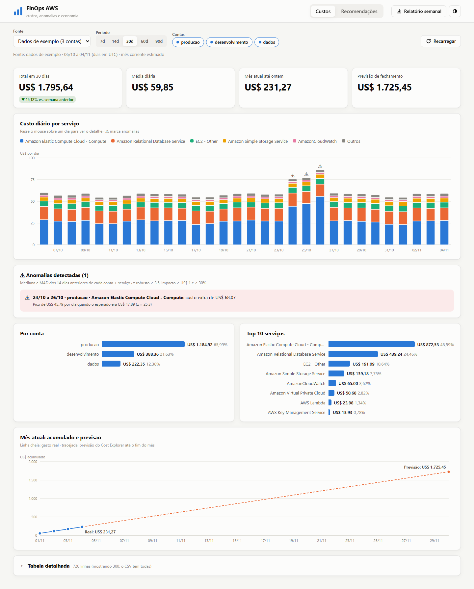
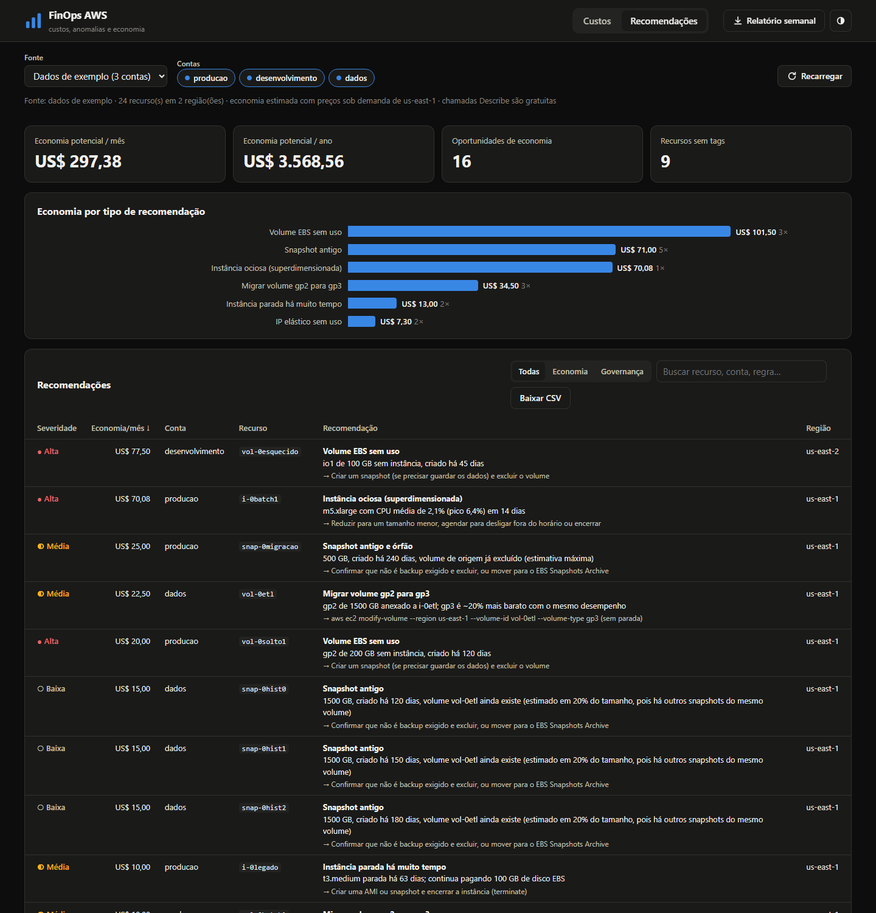
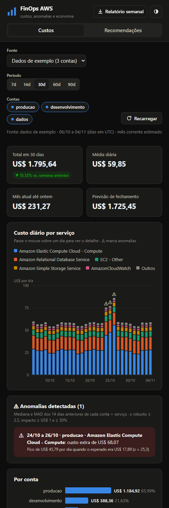
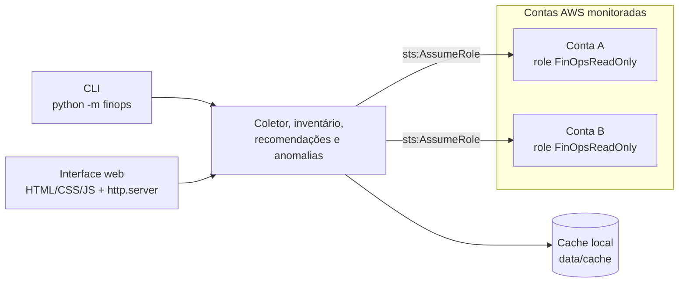

# FinOps AWS

[](https://github.com/pabloaugustoti/finops-aws/actions/workflows/testes.yml)


[](https://docs.astral.sh/ruff/)
[](https://mypy-lang.org/)
[](LICENSE)

**Monitoramento de custos AWS para várias contas**: mostra onde o dinheiro está indo, avisa quando algo foge do padrão e aponta o que dá para economizar, com o comando exato para agir.

Roda **no seu computador**, acessa a AWS só com **permissão de leitura** e tem uma interface web **feita à mão** (HTML, CSS e JavaScript puros, sem frameworks).

🇺🇸 [English version](README.en.md)



---

## O que faz

| | |
|---|---|
| 📊 **Custos** | Total, média diária, mês até ontem e **previsão de fechamento**. Custo diário por serviço, ranking por conta e por serviço. |
| ⚠️ **Anomalias** | Detecta dias fora do padrão em cada conta e serviço (mediana + MAD), com o custo extra de cada evento. |
| 💡 **Economia** | 7 regras: instância ociosa, volume EBS sem uso, IP elástico parado, instância parada, gp2→gp3, snapshot antigo/órfão e recursos sem tags. Cada uma com **economia mensal estimada** e a ação sugerida. |
| 🏢 **Várias contas** | Assume uma role **somente leitura** em cada conta (`sts:AssumeRole`), sem chaves espalhadas. Se uma conta falhar, as outras continuam. |
| 📝 **Relatório semanal** | Markdown pronto para e-mail, Slack ou wiki: semana × semana anterior, anomalias e maiores oportunidades. |

<table>
  <tr>
    <td width="72%"></td>
    <td width="28%"></td>
  </tr>
  <tr>
    <td align="center"><sub>Recomendações, tema escuro</sub></td>
    <td align="center"><sub>Celular</sub></td>
  </tr>
</table>

<sub>As capturas usam o modo de **dados de exemplo**: 3 contas fictícias com desperdício e uma anomalia plantados de propósito.</sub>

## Início rápido (sem conta AWS)

Requer Python 3.12 ou mais novo.

```powershell
python -m venv .venv
.\.venv\Scripts\python.exe -m pip install -e .
.\.venv\Scripts\python.exe -m finops web        # abre http://127.0.0.1:8000 com os dados de exemplo
```

## Destaques técnicos

| Decisão | Por quê |
|---|---|
| **Cache com regra de validade** ([`cache.py`](src/finops/cache.py)) | O Cost Explorer cobra US$ 0,01 por chamada. Período fechado fica em cache para sempre; mês aberto (estimado) expira em 6 h. |
| **Role somente leitura em CloudFormation** ([template](infra/cloudformation/finops-readonly-role.yaml)) | Menor privilégio, com a prova no [diário 04](docs/diario/04-multi-conta-assume-role.md): `CreateVolume` → `UnauthorizedOperation`. |
| **Mediana + MAD para anomalias** ([`anomalies.py`](src/finops/anomalies.py)) | O próprio pico não distorce a linha de base. Acha exatamente a anomalia plantada, sem falsos positivos nas outras 23 séries. |
| **Economia estimada com honestidade** ([`recommendations.py`](src/finops/recommendations.py)) | Sem contagem dupla (gp2→gp3 × instância parada) e com snapshots tratados como incrementais: o total caiu de US$ 484 para US$ 297, um número defensável. |
| **Servidor só com a biblioteca padrão** ([`server.py`](src/finops/web/server.py)) | `127.0.0.1`, só GET, CSP `default-src 'self'`, bloqueio de *path traversal*: tudo coberto por testes. |
| **Gráficos SVG desenhados à mão** ([`charts.js`](src/finops/web/static/charts.js)) | Escalas, eixos, tooltip e cursor sem biblioteca; paleta validada para daltonismo, com tema escuro próprio. |
| **Cliente de exemplo no formato da API real** ([`sample_client.py`](src/finops/sample_client.py)) | O resto do código não distingue dado real de exemplo: dá para demonstrar e testar sem AWS. |
| **SCP tratada como governança, não como erro** ([diário 06](docs/diario/06-motor-de-recomendacoes.md)) | A conta vive numa organização que bloqueia 16 regiões; o inventário mostra isso numa linha em vez de 16 erros. |

## Arquitetura



| Fonte AWS | Uso | Custo |
|---|---|---|
| Cost Explorer | Custos por serviço/conta e previsão | US$ 0,01 por requisição (com cache) |
| EC2 / EBS (`Describe*`) | Inventário para as recomendações | Gratuito |
| CloudWatch | CPU de 14 dias das instâncias | Centavos por milhares de métricas |
| Budgets | Verificação de acesso | Gratuito |

## Comandos

| Comando | O que faz |
|---|---|
| `finops web` | Interface web em `http://127.0.0.1:8000` |
| `finops resumo` | Resumo de custos no terminal (`--csv` exporta) |
| `finops recomendacoes` | Oportunidades de economia (`--regioes`, `--csv`) |
| `finops anomalias` | Eventos de custo fora do padrão (`--sensibilidade`) |
| `finops relatorio` | Relatório semanal em Markdown (`--saida arquivo.md`) |
| `finops verificar-contas` | Testa o AssumeRole e a leitura em cada conta |
| `finops limpar-cache` | Apaga as respostas da AWS guardadas em cache |

Todos aceitam `--fonte exemplo` (padrão, sem AWS), `--fonte aws --perfil <perfil>` (uma conta) ou `--fonte contas` (várias, via `accounts.local.toml`).

## Usar com contas reais

1. Faça login no AWS CLI: `aws login --profile finops-lab` (credenciais temporárias, sem chaves).
2. Em cada conta monitorada, implante a role somente leitura, informando o ID da conta "hub" (de onde o coletor roda):
   ```powershell
   aws cloudformation deploy --template-file infra/cloudformation/finops-readonly-role.yaml `
     --stack-name finops-readonly-role --capabilities CAPABILITY_NAMED_IAM `
     --parameter-overrides TrustedAccountId=<ID_DA_CONTA_HUB> --profile <perfil-da-conta>
   ```
3. Copie [`accounts.example.toml`](accounts.example.toml) para `accounts.local.toml` (ignorado pelo Git) e liste as contas.
4. Confira: `python -m finops verificar-contas`. Depois, `python -m finops web` e escolha **Várias contas**.

O passo a passo de criação da conta AWS está em [docs/checklist-conta-aws.md](docs/checklist-conta-aws.md).

## Segurança

- **Nenhuma credencial no repositório**: perfis do AWS CLI com credenciais temporárias; o pre-commit bloqueia chaves privadas e credenciais AWS.
- **Somente leitura**: a role não tem nenhuma permissão de escrita, e a interface só aceita GET.
- **Dados reais fora do Git**: cache, exportações e o arquivo de contas são ignorados.
- **Interface local**: escuta só em `127.0.0.1`, com Content-Security-Policy restrita e DOM montado sem `innerHTML`.

## Qualidade de código

| Ferramenta | O que garante |
|---|---|
| **ruff** | lint (incluindo regras de segurança) e formatação padronizada |
| **mypy** | tipos consistentes em todo `src/` |
| **pytest + coverage** | 80 testes, sem acessar a AWS (botocore `Stubber` e servidor HTTP real em porta livre); cobertura mínima de 90% (atual: 92%) |
| **pre-commit** | todas as checagens antes de cada commit |
| **GitHub Actions** | lint, tipos e testes em Python 3.12 e 3.14 em todo PR |

```powershell
.\.venv\Scripts\python.exe -m pip install -e ".[dev]"
.\.venv\Scripts\Activate.ps1
python -m pre_commit install       # liga as checagens no git commit
python -m pytest --cov             # testes com cobertura
```

## Estrutura

```
finops-aws/
├── src/finops/
│   ├── cli.py                # linha de comando (python -m finops)
│   ├── sources.py            # fontes de dados: exemplo, uma conta, várias contas
│   ├── cost_explorer.py      # API do Cost Explorer com paginação e cache
│   ├── cache.py              # cache em disco (fechado = permanente, estimado = 6 h)
│   ├── collector.py          # coleta multi-conta com falhas isoladas
│   ├── accounts.py           # leitura e validação do accounts.local.toml
│   ├── aws_session.py        # perfil do CLI e AssumeRole
│   ├── inventory.py          # inventário EC2/EBS/snapshots/IPs em todas as regiões
│   ├── pricing.py            # tabela de preços de referência
│   ├── recommendations.py    # regras de desperdício e economia estimada
│   ├── anomalies.py          # detecção de anomalias (mediana + MAD)
│   ├── weekly_report.py      # relatório semanal em Markdown
│   ├── report.py             # saída de texto e CSV da CLI
│   ├── sample_client.py      # dados de exemplo no formato da API real
│   ├── sample_inventory.py   # inventário de exemplo com desperdício proposital
│   └── web/
│       ├── server.py         # http.server da biblioteca padrão
│       ├── api.py            # monta o JSON da interface
│       └── static/           # index.html, styles.css, app.js, charts.js
├── infra/cloudformation/     # role FinOpsReadOnly
├── tests/                    # 80 testes
├── docs/
│   ├── diario/               # o registro de cada etapa
│   └── img/                  # capturas de tela
└── pyproject.toml
```

## Como o projeto foi construído

Cada etapa virou um PR e uma entrada no diário, com o que foi feito, as decisões, os problemas encontrados e o que aprendi.

| Versão | Etapa | Diário |
|---|---|---|
| v0.1 | Conta AWS, budget e primeiro acesso pela API | [01](docs/diario/01-preparacao-ambiente.md), [02](docs/diario/02-conta-aws-e-primeiro-acesso.md) |
| v0.2 | Coletor do Cost Explorer com cache | [03](docs/diario/03-coletor-cost-explorer.md) |
| v0.3 | Várias contas com AssumeRole | [04](docs/diario/04-multi-conta-assume-role.md) |
| v0.4 | Primeiro dashboard (Streamlit) | [05](docs/diario/05-dashboard-streamlit.md) |
| v0.5 | Motor de recomendações | [06](docs/diario/06-motor-de-recomendacoes.md) |
| v0.6 | Anomalias, relatório semanal e CI | [07](docs/diario/07-anomalias-relatorio-ci.md) |
| v0.7 | Interface web feita à mão | [08](docs/diario/08-interface-web-feita-a-mao.md) |
| v0.8 | Qualidade de código | [09](docs/diario/09-qualidade-de-codigo.md) |
| v1.0 | README de portfólio, licença e releases | [10](docs/diario/10-readme-de-portfolio.md) |

O histórico completo de mudanças está no [CHANGELOG](CHANGELOG.md).

## Próximos passos

- [ ] Relatório semanal automático pelo GitHub Actions com **OIDC** (sem chaves guardadas)
- [ ] Histórico de custos em **SQLite**, para tendências de meses sem pagar a API de novo
- [ ] Custo por **tag** (showback por projeto e ambiente)
- [ ] Cobertura de **Savings Plans e Reserved Instances**
- [ ] **CUR 2.0 + Athena** para custo por recurso, numa conta sem a restrição de região da SCP

## Licença

[MIT](LICENSE). Projeto pessoal de estudo e portfólio: nenhuma empresa envolvida e nenhum dado real de terceiros.
