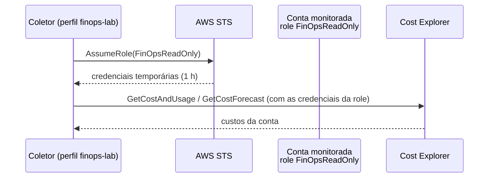

# 04: Várias contas com AssumeRole

**Data:** 2026-11-04

## Objetivo

Preparar o coletor para monitorar **várias contas AWS** com o padrão de mercado: uma conta "hub" assume, em cada conta monitorada, uma role **somente leitura**. Nada de chaves de acesso espalhadas.

## Arquitetura



## O que foi feito

- **Role `FinOpsReadOnly` como código** ([template CloudFormation](../../infra/cloudformation/finops-readonly-role.yaml)):
  - confia apenas na conta hub (`TrustedAccountId`), com `ExternalId` opcional;
  - só permissões de leitura: Cost Explorer, Budgets, Compute Optimizer e inventário de EC2/EBS/CloudWatch (para a fase de recomendações);
  - sessão de no máximo 1 h e tag `Project=finops-aws`.
- **Arquivo de contas em TOML** (`accounts.local.toml`, fora do Git). O TOML é lido pela biblioteca padrão do Python (`tomllib`), sem dependência extra. O formato está documentado em `accounts.example.toml`.
- **Coletor multi-conta** (`collector.py`):
  - cada conta é coletada de forma isolada: se uma falhar, as outras continuam e o erro aparece no relatório;
  - o cache passou a ser **separado por conta**. Antes, duas contas com a mesma consulta iriam compartilhar a mesma resposta em cache, o que seria um bug sério.
- **Relatório com seção "Por conta"** e CSV com a coluna `conta`.
- **Comando `verificar-contas`**: assume a role em cada conta e testa uma leitura (budgets).
- **Modo de exemplo com 3 contas fictícias** (produção, desenvolvimento e dados).
- **35 testes** (12 novos): configuração inválida, AssumeRole com `ExternalId`, falha isolada por conta e cache por conta.

## Resultado na conta real

```
OK    idea-incubator
      identidade: arn:aws:sts::<conta>:assumed-role/FinOpsReadOnly/finops-coletor
      leitura de budgets: 1 encontrado(s)
```

**Prova de menor privilégio**, com a role assumida:

| Ação | Resultado |
|---|---|
| `ec2:DescribeVolumes` (leitura) | ✅ permitido |
| `ec2:CreateVolume` com `DryRun` (escrita) | ❌ `UnauthorizedOperation` |

O `DryRun` testa só a permissão, sem criar nada.

## Problemas encontrados

| Problema | Solução |
|---|---|
| Antes de a role existir, o `verificar-contas` retornava `AccessDenied` no `AssumeRole` | Esperado: a mensagem deixa claro qual role falta |
| O modo automático de permissões do Claude Code bloqueou o `cloudformation deploy` | Aplicar infraestrutura IAM numa conta real exige aprovação humana explícita. Implantado depois da aprovação |
| O teste de escrita com `RunInstances` e uma AMI fictícia retornou `InvalidAMIID.NotFound` | A AWS valida os parâmetros antes da permissão. O teste com `CreateVolume` foi o que comprovou o bloqueio |

## O que aprendi

- **Trust policy × permission policy**: a primeira diz *quem* pode assumir a role; a segunda diz *o que* a role pode fazer.
- **Confiar em `:root`** de uma conta não dá acesso a todo mundo dela: quem assume ainda precisa ter `sts:AssumeRole` na própria identidade.
- **`ExternalId`** protege contra o problema do "confused deputy" quando um terceiro, como uma ferramenta SaaS de FinOps, assume roles em contas de vários clientes.
- **Role chaining** (assumir uma role a partir de outra role) limita a sessão a 1 h.
- **Com AWS Organizations**, a conta de gerenciamento vê o custo de todas as contas num só lugar (`GroupBy LINKED_ACCOUNT`). Sem Organizations, como aqui no Free plan, o caminho é o AssumeRole conta a conta.

## Próximo passo

Fase 4: dashboard (Streamlit) com visão por conta, serviço, tendência e previsão.
