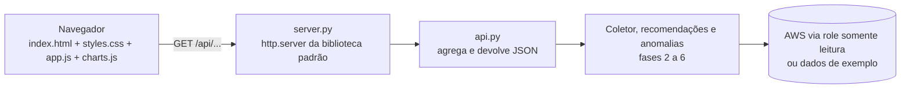

# 08: Interface web feita à mão

**Data:** 2026-11-04

## Objetivo

Trocar o dashboard em Streamlit por uma **interface web própria**: HTML, CSS e JavaScript escritos à mão, sem frameworks, sem bibliotecas de gráfico e sem depender de nenhum serviço de terceiros. Tudo roda no próprio computador.

## Arquitetura

- **Backend** (`src/finops/web/server.py`): `ThreadingHTTPServer` da biblioteca padrão. Rotas:
  - `GET /` e `/static/*`: a interface;
  - `GET /api/custos?fonte=&dias=&contas=`: custos agregados, KPIs, série diária, anomalias e projeção do mês;
  - `GET /api/recomendacoes?fonte=`: recomendações e resumo;
  - `GET /api/relatorio?fonte=`: download do relatório semanal em Markdown.
- **API** (`api.py`): funções puras que montam o JSON, sem pandas, testáveis sem servidor.
- **Frontend** (`static/`): JavaScript puro em módulos ES.
  - `charts.js`: barras empilhadas e linha do mês **desenhadas em SVG por código próprio** (escalas, eixos, cantos arredondados com `clipPath`, tooltip e cursor), além de barras horizontais em HTML/CSS;
  - `app.js`: estado, filtros, abas, tabelas ordenáveis, busca, exportação CSV e tema.

## Segurança

| Medida | Por quê |
|---|---|
| Escuta só em `127.0.0.1` | Ninguém na rede consegue acessar |
| Só `GET` (outros métodos → 405) | A interface só lê |
| Bloqueio de *path traversal* em `/static/` | `/static/../server.py` → 404 |
| `Content-Security-Policy: default-src 'self'` | Só carrega scripts e estilos do próprio servidor, nada externo |
| Validação dos parâmetros (`fonte`, `dias`, `perfil`) | Entradas inválidas → 400 com mensagem |
| DOM montado com `textContent`, nunca `innerHTML` com dados | Evita injeção de HTML (XSS) |

## Decisões de design

- **Cores sempre por variável CSS** (`style.fill = "var(--s1)"`): trocar o tema não exige redesenhar os gráficos.
- **Tema claro e escuro com paletas próprias**, validadas para daltonismo. Escolha automática (sistema), claro ou escuro, guardada no navegador.
- **Ordem e cor dos serviços calculadas com todas as contas**: filtrar contas não "repinta" o EC2.
- **Coleta de 90 dias em cache no servidor**: trocar o período ou as contas não gera chamadas pagas.
- **CSV com `;` e vírgula decimal**: abre direto no Excel em português.
- **Responsivo**: testado em 1440 px e 375 px (celular), sem rolagem horizontal.

## Verificação

- **86 testes** (13 novos): formato do JSON, filtro de contas, cache, o **servidor HTTP de verdade** numa porta livre, arquivos estáticos, *path traversal*, parâmetros inválidos e POST bloqueado.
- No navegador:
  - dados de exemplo, tooltip por dia, anomalia marcada com ⚠, gráfico do mês;
  - aba de recomendações no tema escuro;
  - celular (375 px);
  - conta real (estado vazio, 0 chamadas pagas);
  - console sem erros.

## Problemas encontrados

| Problema | Solução |
|---|---|
| A linha do cursor ficava visível à esquerda antes do mouse entrar | Começa com `display: none` |
| O rótulo "Real" ficava em cima da linha de previsão | Passou para baixo do ponto |
| A coluna "Região" quebrava `us-east-2` em duas linhas | `white-space: nowrap` |
| Teste com espaço na URL quebrava no cliente HTTP | O parâmetro passou a ser codificado (`%20`) |
| `/favicon.ico` → 404 | Rota servindo o ícone SVG |

## O que aprendi

- Um servidor web útil cabe na biblioteca padrão do Python, sem framework.
- Desenhar gráficos em SVG à mão obriga a entender escalas, eixos e acessibilidade: o que uma biblioteca esconde.
- **CSP + `textContent`** são uma defesa simples e forte para interfaces que mostram dados vindos de fora.
