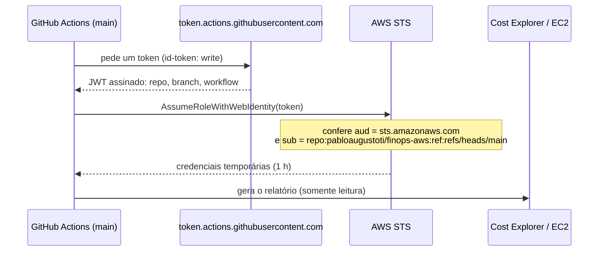

# 11: Relatório semanal automático (OIDC + agendador local)

**Data:** 2026-11-04

## Objetivo

Gerar o relatório semanal sozinho, toda segunda-feira, **sem guardar nenhuma chave de acesso**. O plano era o padrão moderno: GitHub Actions + OIDC.

## Como o OIDC funciona

Não há segredo guardado no GitHub: a confiança vem da **assinatura do token** e das **condições** na role. Um fork, um PR ou outra branch recebem um token com outro `sub` e são recusados.

## O bloqueio: SCP nega provedores OIDC

Ao começar, a primeira consulta já falhou:

> `iam:ListOpenIDConnectProviders ... with an explicit deny in a service control policy`

A conta do Free plan da "nova experiência" vive numa organização gerenciada pela AWS cuja SCP **proíbe provedores de identidade OIDC**. Ou seja, nenhuma identidade externa (GitHub, por exemplo) pode assumir roles nela. Não tentei criar o provedor só para confirmar: seria uma ação de escrita sem resultado útil.

**Decisão:**
1. Deixar o OIDC **pronto como código**, validado e documentado, para ativar em qualquer conta sem essa restrição.
2. Na conta atual, rodar o relatório pelo **Agendador de Tarefas do Windows**, que também funciona sem chaves.

## O que foi feito

**OIDC (pronto, inativo nesta conta)**
- [`github-oidc-report-role.yaml`](../../infra/cloudformation/github-oidc-report-role.yaml): provedor OIDC (opcional, porque só pode existir um por conta) e a role `FinOpsGitHubReport`:
  - confia só em `repo:pabloaugustoti/finops-aws:ref:refs/heads/main` com `aud = sts.amazonaws.com`;
  - permissões mínimas: `ce:GetCostAndUsage`, `ce:GetCostForecast` e os `Describe*`/`GetMetricData` do inventário.
- [`relatorio-semanal.yml`](../../.github/workflows/relatorio-semanal.yml): segunda às 11:00 UTC ou manual. Usa `aws-actions/configure-aws-credentials` com `role-to-assume` e publica o relatório no resumo da execução e como artefato.
  - **Fica pulado enquanto a variável `AWS_ROLE_ARN` não existir**, para não gerar uma falha por semana.
  - O ARN fica numa **variável** do repositório, não no código.
- Código: o perfil especial **`ambiente`** usa as credenciais do ambiente (`AWS_*`), que é o que a action entrega.

**Agendador do Windows (ativo nesta conta)**
- [`relatorio-semanal.ps1`](../../scripts/relatorio-semanal.ps1): roda `finops relatorio --fonte contas --regioes us-east-2` e salva em `data/exports/relatorios/relatorio-AAAA-MM-DD.md`, que fica fora do Git.
  - Mantém um `execucoes.log`.
  - Se o login tiver expirado, grava um `ULTIMO-ERRO.txt` explicando o que fazer (`aws login --profile finops-lab`).
- [`agendar-relatorio.ps1`](../../scripts/agendar-relatorio.ps1): cria ou remove a tarefa (toda segunda às 08:00).
  - Com `StartWhenAvailable`, roda assim que o PC ligar se estava desligado na hora.

## Problemas encontrados

| Problema | Solução |
|---|---|
| SCP nega provedores OIDC | OIDC entregue como código pronto; agendador local na conta atual |
| Teste esperava a região em `AWS_REGION` | O botocore lê `AWS_DEFAULT_REGION`; a action do GitHub define as duas |
| PowerShell 5.1 lê `.ps1` sem BOM como ANSI, o que quebraria os acentos das mensagens | Scripts salvos em UTF-8 **com** BOM |

## O que aprendi

- **OIDC troca segredo por confiança verificável**: o que autoriza é a assinatura do token mais as condições `aud`/`sub`, não uma chave que pode vazar.
- **A condição `sub` é a parte crítica**: sem ela, *qualquer* repositório do GitHub poderia assumir a role.
- **SCP é o teto de tudo**: nem uma conta com `AdministratorAccess` cria o que a organização proíbe. Ler a mensagem de erro com atenção ("explicit deny in a service control policy") economiza horas.
- Entregar algo **pronto e documentado, explicando por que não está ativo**, é melhor do que um atalho inseguro, como uma chave de acesso guardada em segredo do GitHub.
